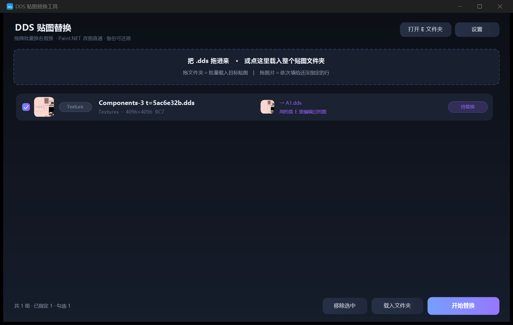

# DDS 贴图替换工具

给游戏模组做 DDS 贴图「**换名替换**」的小工具：把源贴图 A 复制到目标贴图 B 的位置、
改成 B 的名字，同时删掉原来的 B，避免同名冲突。

免安装，单个 exe（约 88 KB），无需 .NET 运行时以外的任何依赖。



## 它做什么

- 源贴图 **A** 在 C 文件夹，要被顶替的贴图 **B** 在 D 文件夹
- 工具把 A 复制过去、改成 B 的文件名，先删掉原来的 B
- 中间多一个**缓冲文件夹 E**：双击某一行 → 把 A 复制到 E → 用 Paint.NET 打开这份副本，
  改完存回 E，替换时用的就是 E 里改好的那张图

## 主要功能

- **拖拽即用**：把要替换的贴图文件夹整个拖进窗口，自动递归列出里面所有 `.dds`，一行一张
- **逐行指定源图**：拖一张或一堆 `.dds` 进来，依次填给还没指定源图的行；也可以拖到某一行上；
  没指定源图的行、没勾选的行，替换时**保持原样不动**
- **缩略图预览**：每行左侧显示目标贴图缩略图，指定源图后源图旁也有小预览
  （借 Windows 缩略图组件解码，BC1 / BC3 / BC7 都能显示）
- **Paint.NET 直通**：双击行即可编辑，保存后自动用 E 里的新版替换
- **备份**：替换前把原 B 备份到 `E\backup\时间\001_原B名.dds`，可一键关掉
- **替换完成后自动打开**结果所在的资源管理器文件夹
- **可换皮肤**：设置里能选背景图、调透明度
- **记录**：操作日志写在 `logs\log_日期.txt`，列表和设置自动保存

## 快速上手

1. 双击 `bin\DDS贴图替换工具.exe`
2. 把要被替换的贴图文件夹拖进虚线框 → 自动列出所有 `.dds`
3. 把源贴图拖到对应行（或拖进虚线框依次填充）
4. 点【开始替换】→ 确认

## 环境要求

- Windows 10 / 11
- .NET Framework 4.8（Win10 1809 之后自带）
- 可选：[Paint.NET 5.x](https://www.getpaint.net/)（用于改图和缩略图解码）

## 从源码编译

本仓库不依赖 Visual Studio / MSBuild，直接用系统自带的 C# 编译器：

```powershell
powershell -NoProfile -ExecutionPolicy Bypass -File .\build.ps1
```

`build.ps1` 会调用 `C:\Windows\Microsoft.NET\Framework64\v4.0.30319\csc.exe`，
把 `src\Program.cs` + `src\Ui.cs` 编译成 `dist\DDS贴图替换工具.exe`。

图标由 `genicon.ps1` 生成（System.Drawing 画多尺寸 PNG 再打包成 ICO）。

## 隐藏参数（自测用）

```
--probe    <报告文件> <dds...>              只解析文件头，输出宽高/格式
--selftest <报告文件>                        跑一遍替换逻辑的 8 个用例
--apply    <报告> <缓冲E> <1|0> <A> <B> ...  无人值守批量替换
```

## 说明

- 贴图处理只读 DDS 的 128 字节文件头拿宽高/格式，不解码像素；看图、改图交给 Paint.NET
- 如果 exe 放在被系统策略限制的目录（某些工作区、同步盘），Windows 可能拒绝它写别的盘，
  日志里会看到「对路径…的访问被拒绝」，把 exe 挪到桌面或 `D:\工具` 之类普通文件夹即可
- 备份写了三级退让：`E\backup` → `%LOCALAPPDATA%\DdsSwapTool\backup` → 就地改名 `.bak_时间`，
  三种都失败也只记日志、不中断替换

## 许可

MIT License，见 [LICENSE](LICENSE)。
